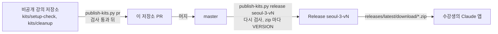

# 101 키트가 나가는 길

수강생은 Claude 앱에 한 줄만 붙여 넣어요. 그러면 Claude 가 이 저장소의 Release 에서 zip 을 받아 풀고, 안의 지시문대로 움직입니다.

## 누가 무엇을 쓰나

- 키트 원본은 비공개 강의 저장소에 있습니다. 이 저장소의 `README.md`, `setup-check/`, `cleanup/`, `.github/build.py` 는 거기서 스크립트로만 들어옵니다.
- 그 밖의 파일(이 문서들, `CLAUDE.md`, `.claude/`)은 이 저장소에서 PR 로 고칩니다.

## 검사는 두 겹이에요

- **공개 규칙** (`.github/build.py`): IP, 12자리 숫자, 키와 토큰, 비밀번호 값, 이메일, 사용자 폴더, 자리표시(`[확인 필요`, 번호 없는 TODO).
- **비공개 규칙**: 강의 사이트 주소처럼 여기 적으면 안 되는 것들입니다. 강의 저장소의 publish 단계에서만 더합니다.

하나라도 걸리면 PR 도 Release 도 멈춥니다!

## 판(VERSION)

- Release 이름은 `seoul-3-v1`, `seoul-3-v2` 처럼 올라가요. zip 안 `VERSION` 파일에도 같은 판이 적힙니다.
- 키트는 시작할 때 `api.github.com` 의 최신 태그와 비교합니다. 예전 판이면 공식 주소에서 다시 받아요.
- 그래서 한 번 낸 태그는 지우거나 바꾸지 않습니다.

## 앞으로

- GitHub Actions 로 Release 를 자동으로 만들 예정입니다. 공개 저장소라 무료이고, 비공개가 되면 건너뜁니다.
- 키트 말고 다른 zip(예: 시작 꾸러미)은 `extras/` 에 넣습니다. 푸르공님이 사용 조건을 확인하신 뒤에만 넣어요.
