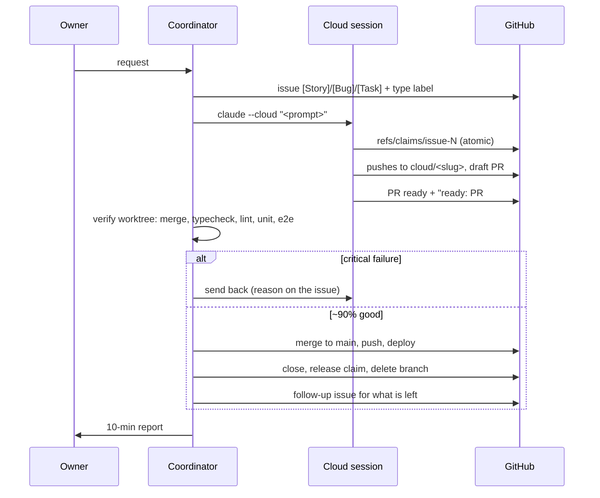
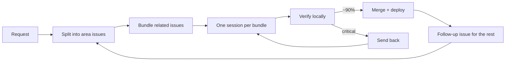

# Workflow (mmk-crew)

Who does what, in what order, and how the coordinator keeps the backlog moving without the owner.
Protocol and hooks: [CLOUD.md](CLOUD.md).

## Roles

| Who | Does |
|---|---|
| Owner | Says what they want. Answers only real product choices. |
| Coordinator (local session) | Splits requests into issues, launches cloud sessions, watches, verifies on the local machine, merges, deploys, closes, reports every 10 min. |
| Cloud session | One issue: claim → work → PR → ready → stop. |

## One issue



## Splitting work: by behaviour area, not by file

Two PRs that each pass alone can break together. List the project's areas in the table below (each with the e2e
that covers it). Default: the coordinator itself does related stories in sequence, 3 to 5 on one branch, one PR, one verify and one
apply (11/3 transcribe-hub: 6 issues in 59 min, 0 conflicts, 0 follow-ups, vs parallel ~15 to 22 min per issue with 4
conflicts and 25 follow-ups). Routing (owner, 11/3): light, self-contained issues (a bug, a small task, docs) → hand straight to a cloud session.
Big work → gather the related stories and do them locally: one at a time by the coordinator, or at most 2 at once in
separate local worktrees when the two groups touch different areas.
Hot files (`coord.json` `hot`) are claimed by `file#symbol` only.

| Area | Covers | e2e to run |
|---|---|---|
| Setup check kit | `setup-check/` (published from the course repo): what Claude checks and installs before the workshop | VERIFY.md steps 1 to 3 with `bash setup-check/check.sh --plan`; Windows test machine for `check.ps1` |
| Cleanup kit | `cleanup/` (published from the course repo): what Claude takes down and signs out after the workshop | VERIFY.md steps 1 to 3 (zip list and VERSION); the cleanup itself only on a practice AWS account |
| Release | `.github/build.py` (published), Releases `seoul-3-vN`, the `latest` download addresses | VERIFY.md step 3: anonymous `curl -L` of both `latest` addresses → 200 and the right VERSION |
| Student front page and repo docs | `README.md` (published), `CLAUDE.md`, `docs/` | read the page on github.com; `build.py check` |

## Merge bar: ~90%

| Bucket | What | Action |
|---|---|---|
| Critical | build/typecheck/lint fails; page errors or crash; a core e2e that passes on main fails ≥2/3; basic controls broken; clear perf regression; real data or security | send back with the reason |
| Minor | a ~1/3 flaky test (run it on main first: flaky there too → not the PR's); polish; balance numbers; target partly met; timing in the PR's own new test | merge + follow-up issue linked from the merged one |
| Tiny | one or two lines (selector, screenshot embed, typo) | coordinator fixes it in the verify worktree and merges |

Say which bucket each finding went into in the report.

## Self-driving loop



Every report tick:
1. A session with no push for 30+ min: message it (`claude -p "<msg>" --cloud <session_id>`); silent again → reassign.
2. "ready" arrived: verify (batch if several), merge, deploy, close, release, follow-ups.
3. Open, unclaimed issues (not on hold, its `Starts after #N` closed): bundle them first. Issues that are more
   efficient together or would collide as separate PRs (same files) go into one bundle = one local worktree session on
   a strong model, one branch, one PR with a commit per issue. Only a small issue that touches nothing else in flight
   takes a free cloud slot (`maxCloud`). (owner rule 2026-11-04)
4. Local-only work (GPU e2e, flaky tests, owner-reported screen issues) the coordinator does between ticks.

## Report format (every 10 min, owner's timezone)

```
## 반영 완료 (HH:MM TZ)      ← merged since the last report, or "없음"
## 작업 중                     ← issue | state | one line; a send-back always says why
## 앞으로 할 것                 ← queued issues, anything that needs the owner
```
- Shared entry files (Makefile, go.mod, package.json, main router): one owner issue creates them; name it in the other issues' bodies so parallel sessions don't both create them.
- Coordinator keeps sessions never idle: merged PR -> close session -> next issue assigned at once (deps, file overlap, approvals checked). See the coordinator skill.
- Every PR body has a spec conformance table (issue items and mockup screens -> done/partial/missing with evidence). Reviewers merge only when nothing is missing or the gap has an agreed follow-up issue. Tests passing is not enough.
